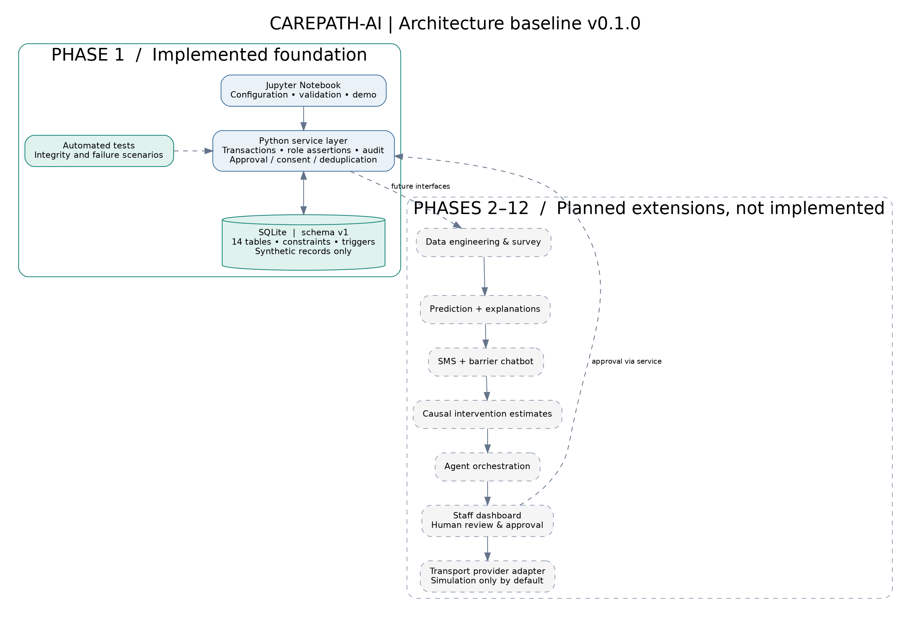

# CarePath-AI

[](LICENSE)

**A Human-Centred Causal and Agentic AI Framework for Healthcare Appointment Attendance**

`Python` · `Jupyter Notebook` · `SQLite` · `Research prototype`  
**v0.2.0 - Phase 2 of 12 - Synthetic data only**

## Overview
CarePath-AI investigates appointment attendance barriers, with predictive risk, causal intervention analysis and coordination under human supervision planned for future public releases. This is a research prototype, not an NHS product.

This release provides a relational SQLite foundation, reusable Python services, fictional demonstration workflows, consent checks and human approval safeguards. Risk scores are illustrative placeholders. Phase 2 adds longitudinal synthetic appointments, structured surveys, exploratory analysis, chronological splits, preprocessing fitted on training data only and isolated synthetic causal ground truth.

## Release at a glance
| Metric | Result |
| --- | ---: |
| Synthetic appointments | 50,000 |
| Synthetic patients | 12,500 |
| Survey responses | 40,052 |
| Eligible ML records | 45,676 |
| Integrated database tables | 17 |
| Automated tests passed | 47/47 |
| Data checks passed | 26/26 |
| Database checks passed | 10/10 |

Figures are from the original development reports, not real world healthcare performance.

## System architecture


## Quick start
Clone the repository or download the source snapshot to recreate generated artefacts. Open a terminal in the extracted `CarePath-AI` directory. Python 3.11-3.13 is recommended.

```sh
python -m venv .venv
```

Activate with `.venv\Scripts\Activate.ps1` on Windows PowerShell or `source .venv/bin/activate` on macOS/Linux. If activation is restricted, invoke the environment's Python directly.

```sh
python -m pip install -r requirements.txt
python -m notebook
```

Open `notebooks/Phase_02_Data_Engineering.ipynb` and select **Restart Kernel and Run All Cells**. Phase 2 uses its own integrated database; do not point Phase 1 at it. Run independent tests from the project root:

```sh
python -m unittest discover -s tests -v
```

The notebook recreates the synthetic CSVs, integrated SQLite database and preprocessing artefacts locally. These generated files are excluded from Git; a complete executable release archive may be distributed separately. Keep the directory structure intact.

## Documentation and reproducibility
* [Foundation notebook](notebooks/Phase_01_Foundation.ipynb)
* [Requirements](documentation/requirements.md) · [Data dictionary](documentation/data_dictionary.md) · [ERD](documentation/erd.svg)
* [Foundation tests](reports/test_results.txt) · [Validation](reports/validation_report.json)
* [Phase 2 notebook](notebooks/Phase_02_Data_Engineering.ipynb)
* [Research methodology](documentation/phase2_methodology.md) · [Data dictionary](documentation/phase2_data_dictionary.md)
* [Phase 2 tests](reports/phase2/test_results.txt) · [Validation](reports/phase2/validation.json) · [Split summary](reports/phase2/split_summary.csv)

See the [changelog](CHANGELOG.md) for release history. The numerical results and test reports document the original development experiments. The automated tests and notebooks support reproducibility.

## Development roadmap
| Phase | Scope | Snapshot status |
| --- | --- | --- |
| 1 | System architecture & foundations | Implemented |
| 2 | Data engineering & patient survey | Implemented |
| 3 | Predictive ML | Not included |
| 4 | Explainable AI | Not included |
| 5 | Causal AI | Not included |
| 6 | Automated communication | Not included |
| 7 | Patient chatbot | Not included |
| 8 | Agentic AI | Not included |
| 9 | Transport coordination | Not included |
| 10 | Staff dashboard | Not included |
| 11 | Integration & validation | Not included |
| 12 | Final research package | Not included |

## Responsible use and limitations
All records and intervention effects are synthetic. No trained predictive or causal estimator, real messages, bookings or NHS integration. Local SQLite is unencrypted; demo actor IDs are not authentication and direct SQL/file access can bypass controls. Not clinically validated or for actual patient decisions. Windows was not directly tested. Optional graphical survey widget rendering was not verified; the editable form and backend were tested. Notebook cells completed in the original build, with kernel connection/shutdown issues reported. Numerical library versions can affect reproducibility. Never use oracle values as predictors.

## Citation and contribution transparency
Please use [CITATION.cff](CITATION.cff) when citing this release. AI assistance was used in software development and documentation. The project remains a research prototype; independent adoption and research novelty have not been established.

## Research and healthcare disclaimer
CarePath-AI is an experimental research and software engineering prototype using synthetic healthcare data. It has not been clinically validated and is not intended for clinical diagnosis, medical advice, autonomous healthcare decisions or actual patient management. It is not affiliated with or endorsed by the NHS. Real-world deployment requires appropriate regulatory, ethical, clinical, privacy and security assessment and authorisation. This statement is separate from the Apache License 2.0 warranty and liability provisions.

## Licence and attribution
Copyright 2026 Samudra De Silva, to the extent copyright is held by the project author. Materials owned by the project author are licensed under the [Apache License 2.0](LICENSE). See [NOTICE](NOTICE) for attribution and third party licensing information. Third party dependencies retain their own licences.
